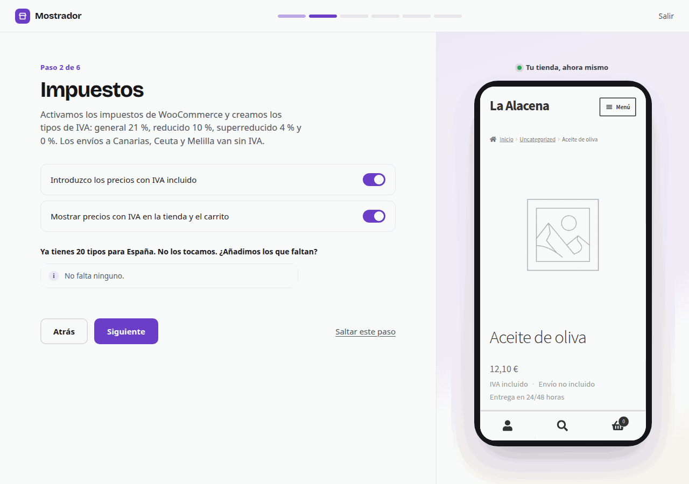
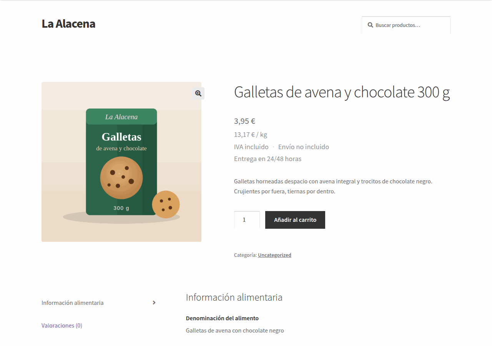
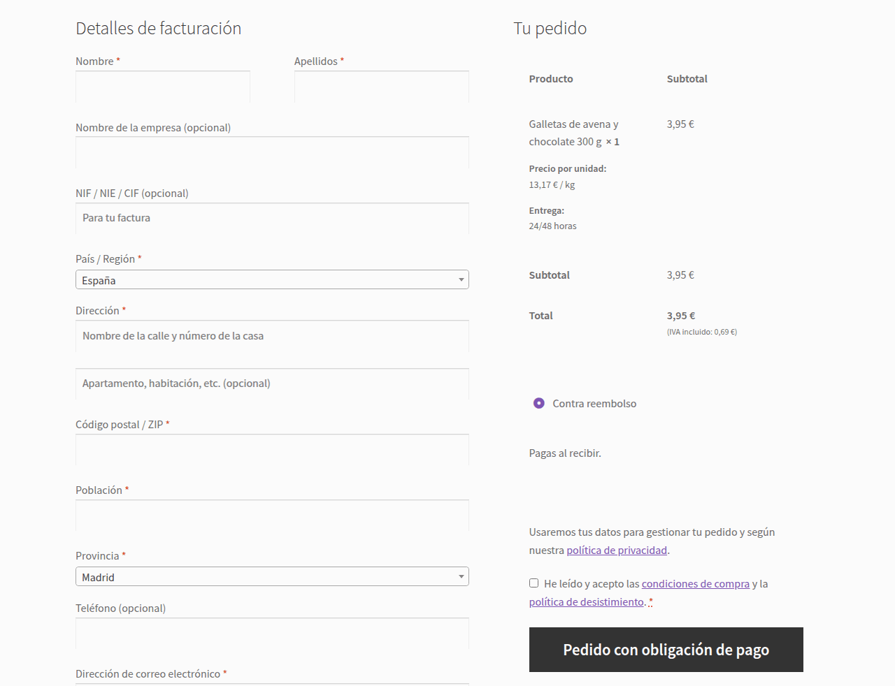
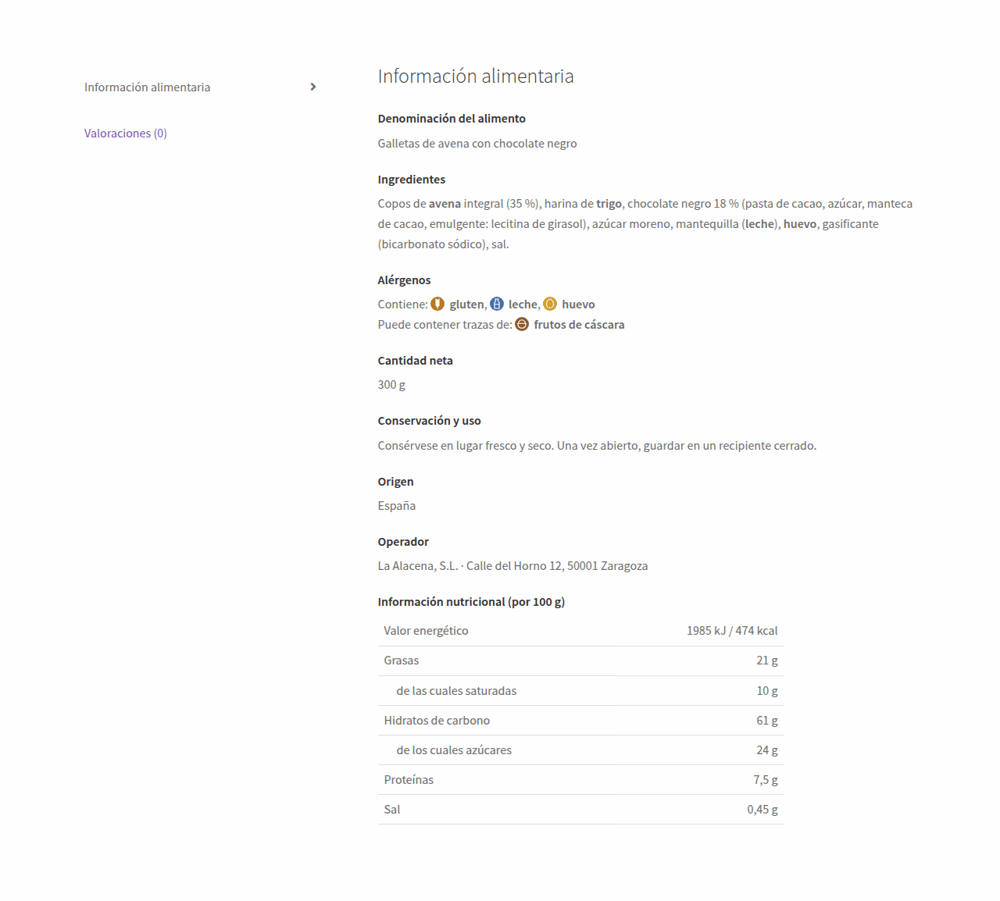
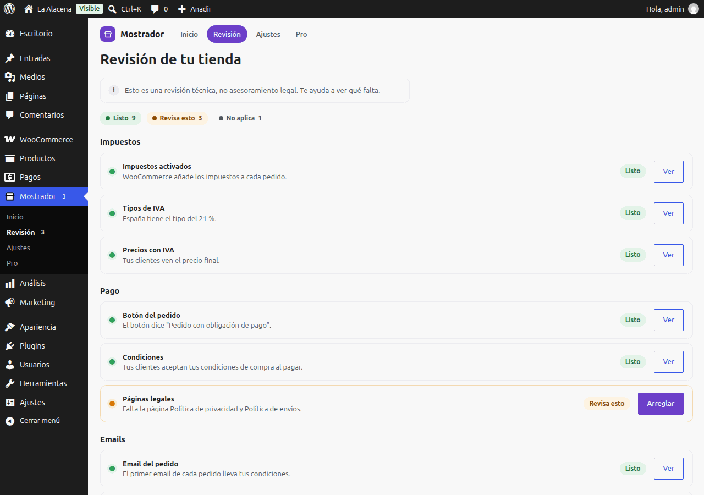

# Mostrador para WooCommerce

**Qué es:** un plugin gratuito de WordPress que deja tu tienda WooCommerce lista para vender en España: NIF en el checkout, botón "Pedido con obligación de pago", "IVA incluido", precio por kilo o litro, alérgenos y los tipos de IVA españoles.\
**Para quién:** tiendas online en España que venden con WooCommerce, sin necesidad de saber programar.\
**Cómo se usa:** 1) descarga el zip, 2) súbelo en WordPress y actívalo, 3) sigue el asistente de cinco minutos y mira en **Mostrador → Revisión** qué te falta.

👉 **[Descargar mostrador.zip](https://github.com/Facilo-es/mostrador/releases/latest/download/mostrador.zip)** (última versión, gratis)

Mostrador no crea facturas ni es asesoría legal o fiscal: sigues usando tu programa de facturación.

## Así se ve

*El asistente activa los impuestos y crea los tipos de IVA de España, y te enseña cómo queda tu tienda mientras eliges.*

*En la ficha, el cliente ve el precio por kilo, "IVA incluido", "Envío no incluido" y cuándo le llega el pedido.*

*En el checkout, el cliente escribe su NIF, NIE o CIF para su factura, y el botón dice "Pedido con obligación de pago".*

*Para alimentación: ingredientes, los 14 alérgenos con iconos e información nutricional en su propia pestaña.*

*La revisión te dice qué está listo y qué falta, y el botón "Arreglar" te lleva a corregirlo.*

## Lo que gana tu tienda

- **Facturas sin errores:** el cliente escribe su NIF, NIE o CIF en el checkout y se comprueba al momento. Nada que corregir después.
- **Un botón de compra claro:** "Pedido con obligación de pago", como pide la ley, para que nadie diga que no sabía que pagaba.
- **Precios que generan confianza:** "IVA incluido", gastos de envío y precio por kilo o por litro junto al precio.
- **Menos dudas antes de comprar:** plazo de entrega por producto, fabricante y advertencias (GPSR) y los 14 alérgenos en una pestaña, con filtro "Sin gluten" o "Sin leche".
- **Correos completos sin tocar plantillas:** tus condiciones y el formulario de desistimiento en el primer correo del pedido.
- **Los tipos de IVA de España creados por ti,** con Canarias, Ceuta y Melilla sin IVA.
- **Una revisión de la tienda** que te dice qué falta y te lleva a arreglarlo.

En español, y también en alemán, francés, italiano, portugués, neerlandés y polaco. La versión gratuita no se conecta a ningún servicio externo.

## Descarga e instalación

1. Descarga **[mostrador.zip](https://github.com/Facilo-es/mostrador/releases/latest/download/mostrador.zip)** (última versión).
2. En WordPress, ve a **Plugins → Añadir nuevo → Subir plugin**, elige el zip y actívalo. Necesitas WooCommerce activo.
3. Se abre el asistente: elige dónde está tu tienda, tus impuestos, tu checkout, tus productos y tus correos. Después, **Mostrador → Revisión** te dice qué falta.

**Actualizaciones:** por ahora, cada versión nueva se publica en [Releases](https://github.com/Facilo-es/mostrador/releases) de este repositorio: descarga el zip y súbelo igual que la primera vez; WordPress te ofrece reemplazar la versión instalada. Cuando Mostrador esté publicado en wordpress.org, las actualizaciones llegarán también desde ahí, en **Escritorio → Actualizaciones**.

## Preguntas frecuentes

**¿Los precios de Pro (49 € y 99 €) llevan el IVA incluido?**
No. Son precios sin IVA: al pagar se suma el IVA que corresponda. En España, con el 21 %, son 59,29 € y 119,79 € al año.

**¿El NIF se comprueba en algún registro oficial?**
No. La versión gratuita comprueba el formato y la letra o el dígito de control del NIF, NIE o CIF, dentro de tu propia web y sin conectarse a ningún servicio. No consulta a Hacienda, así que un NIF bien escrito pero que no existe pasaría. Pro, además, comprueba el NIF-IVA de empresas de otros países de la UE en VIES, el servicio oficial de la Comisión Europea que consulta los registros de cada país.

**¿Qué versiones necesito?**
WordPress 6.6 o superior (probado hasta la 7.1), WooCommerce 9.0 o superior (probado hasta la 11.2) y PHP 7.4 o superior. Funciona con el checkout clásico y con el de bloques, y con el almacenamiento de pedidos de alto rendimiento (HPOS).

**¿Choca con mi plugin de facturación o con otros plugins del checkout?**
Mostrador no crea ni numera facturas, así que no compite con tu plugin de facturación. Los impuestos que crea son impuestos normales de WooCommerce y el NIF se guarda en el pedido (campo `_billing_nif`), donde tu programa de facturación puede leerlos. Si ya usas el plugin WC APG NIF, Mostrador lo detecta y no añade un segundo campo NIF.

## Mostrador Pro: para tiendas que venden a empresas

Recargo de equivalencia automático para clientes minoristas, retención de IRPF en ventas a empresas y profesionales, comprobación del NIF-IVA europeo para vender sin IVA a empresas de la UE, edición masiva e importación CSV, resumen trimestral para tu gestoría, métricas de producto y seis estilos con tus colores.

**49 € al año para una tienda, 99 € al año para diez, más IVA.** 14 días de garantía de devolución.

👉 **[Comprar Mostrador Pro](https://checkout.freemius.com/plugin/44922/plan/79190/)**

## Importante

Mostrador es una herramienta, no asesoría legal ni fiscal: cada tienda sigue siendo responsable de sus textos e impuestos. Mostrador no emite facturas ni las numera; sigue usando tu programa de facturación.

**Quién lo hace:** Facilo, un pequeño estudio de Andalucía · support@facilo.es · [facilo.es](https://facilo.es) · Licencia GPLv2 o posterior.
